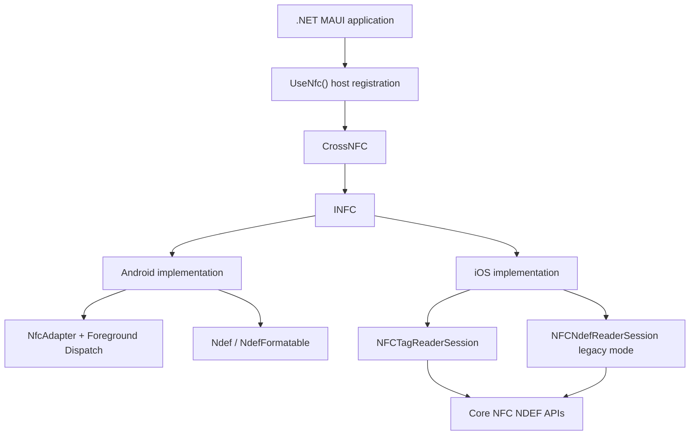
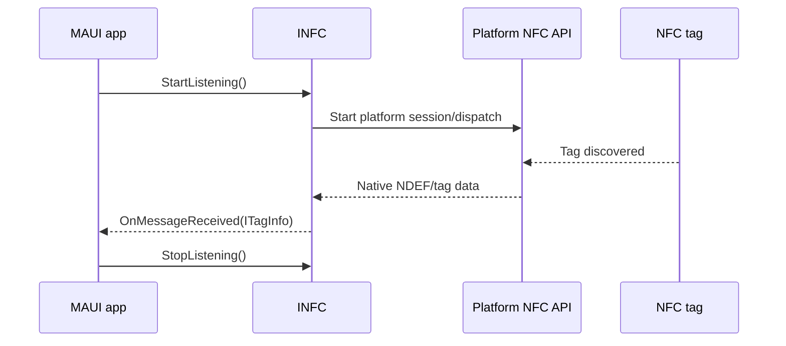
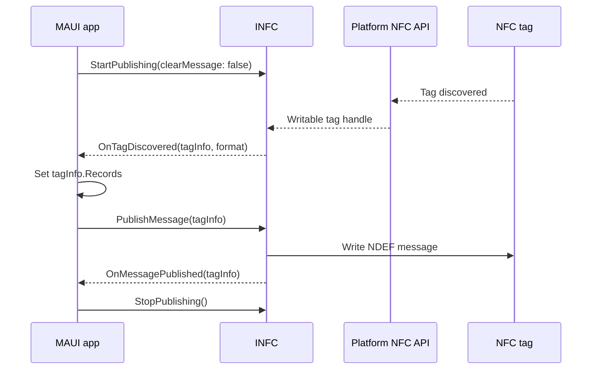

#  Shaunebu.MAUI.NFC

[](https://www.nuget.org/packages/Shaunebu.MAUI.NFC)
[](https://www.nuget.org/packages/Shaunebu.MAUI.NFC)


[](LICENSE)


**Shaunebu.MAUI.NFC** is a focused, event-driven NFC plugin for .NET MAUI apps that need to read, write, clear, and optionally lock NDEF tags on Android and iOS without duplicating platform-specific NFC plumbing in every app.

It wraps Android NFC foreground dispatch and Apple Core NFC behind one small consumer API, while still exposing the practical tag information app developers need: serial number, identifier bytes, capacity, writability, NDEF records, and platform support flags.

> [!IMPORTANT]
> This package is for real Android and iOS devices with NFC hardware. NFC simulators/emulators are not a reliable way to validate real tag behavior.

---

## Contents

- [Overview](#overview)
- [Feature Matrix](#feature-matrix)
- [Why This Library](#why-this-library)
- [Supported Platforms](#supported-platforms)
- [Installation](#installation)
- [Quick Start](#quick-start)
- [Platform Configuration](#platform-configuration)
- [Architecture](#architecture)
- [Core Features](#core-features)
- [API Overview](#api-overview)
- [Threading Model](#threading-model)
- [Supported Tag Types](#supported-tag-types)
- [NDEF Support](#ndef-support)
- [Error Handling](#error-handling)
- [Best Practices](#best-practices)
- [Security](#security)
- [Troubleshooting](#troubleshooting)
- [Examples](#examples)
- [FAQ](#faq)
- [Roadmap](#roadmap)
- [Contributing](#contributing)
- [License](#license)
- [References](#references)

---

## Overview

### What Problem Does It Solve?

NFC support in a .NET MAUI app quickly becomes platform-specific:

| Concern | Android | iOS |
| --- | --- | --- |
| Session model | Foreground dispatch and NFC intents | Core NFC reader sessions |
| App wiring | Manifest, lifecycle callbacks, optional intent filters | Entitlements, usage description, device capability |
| Tag access | `NfcAdapter`, `Tag`, `Ndef`, `NdefFormatable` | `NFCTagReaderSession`, `NFCNdefReaderSession`, `INFCNdefTag` |
| NDEF conversion | Android `NdefRecord`/`NdefMessage` | Core NFC `NFCNdefPayload`/`NFCNdefMessage` |
| Common failures | stale reads, tag lost, format/write errors | user cancellation, multiple tags, session timeout |

Shaunebu.MAUI.NFC keeps that platform work behind `INFC`, so your app can focus on what a scanned tag means and what should be written to it.

### When To Use It

Use this library when your .NET MAUI app needs:

- ✅ NDEF tag reads on Android and iOS.
- ✅ NDEF writes for text, URI, MIME, external, and empty records where the platform/tag supports them.
- ✅ Tag clearing/formatting through the current publish flow.
- ✅ Access to tag identifiers, serial numbers, capacity, writability, and support flags.
- ✅ Android app launch through an NDEF MIME intent filter.
- ✅ iOS Core NFC sessions with configurable user-facing session messages.
- ✅ A small event-based API that is easy to add to existing MAUI pages.

### When Not To Use It

This library is intentionally not a full NFC protocol toolkit. It is not the right fit if you need:

- ❌ Android Reader Mode. The current Android implementation uses Foreground Dispatch.
- ❌ A fully asynchronous read/write API with task completion and cancellation tokens.
- ❌ Unknown-record authoring or low-level raw NDEF write APIs beyond supported record types.
- ❌ Low-level APDU/transceive workflows for ISO 7816, FeliCa, MIFARE, or ISO 15693 commands.
- ❌ Windows, macOS, Mac Catalyst, Linux, or simulator-first NFC behavior.

### Target Audience

Shaunebu.MAUI.NFC is built for MAUI developers shipping mobile apps that use NFC for everyday product, inventory, onboarding, access, pairing, asset, or deep-link workflows. It aims to be approachable for app teams that understand their payloads but do not want every screen to know the Android and iOS NFC stacks.

### Design Philosophy

| Principle | What It Means |
| --- | --- |
| Small public surface | Keep the API centered on `INFC`, events, `ITagInfo`, and `NFCNdefRecord`. |
| Platform honesty | Document Android/iOS differences instead of pretending NFC behaves identically everywhere. |
| NDEF-first | Optimize for NFC Forum Data Exchange Format records, not custom low-level protocols. |
| Event compatibility | Preserve the existing event-driven API for current consumers. |
| App-owned UX | Let apps decide how to subscribe, display results, stop sessions, and guard destructive actions. |

### Goals

- Make common NDEF read/write flows straightforward in .NET MAUI.
- Provide predictable package assets for NuGet consumers.
- Preserve compatibility with existing consumers of the event API.
- Keep platform-specific behavior visible where it affects app correctness.

### Non-Goals

- No Reader Mode implementation in the current release.
- No lifecycle redesign in the current release.
- No async/cancellation redesign in the current release.
- No default logging provider or diagnostics sink; diagnostics are opt-in through `NfcOptions.LoggerFactory`.
- No CI/GitHub Actions changes in the current manual release-validation flow.

---

## Feature Matrix

| Feature | Supported | Platform | Notes |
| --- | --- | --- | --- |
| Check whether the platform implementation exists | ✅ | Android, iOS | `CrossNFC.IsSupported`. |
| Check NFC availability | ✅ | Android, iOS | Android checks adapter and NFC permission; iOS uses Core NFC availability. |
| Check NFC enabled state | ✅ | Android, iOS | Android reflects adapter enabled state; iOS mirrors availability. |
| Read NDEF tags | ✅ | Android, iOS | Raises `OnMessageReceived`. |
| Write NDEF tags | ✅ | Android, iOS | Uses `StartPublishing()` and `PublishMessage(ITagInfo)`. |
| Clear/format tags | ✅ | Android, iOS | Uses `StartPublishing(clearMessage: true)` or `ClearMessage(ITagInfo)`. |
| Make tags read-only | ✅ | Android, iOS | `PublishMessage(tagInfo, makeReadOnly: true)`; permanent operation. |
| Android NFC status changed event | ✅ | Android | `OnNfcStatusChanged`; backed by adapter state broadcast. |
| Listening status event | ✅ | Android, iOS | `OnTagListeningStatusChanged`. |
| iOS cancellation event | ✅ | iOS | `OniOSReadingSessionCancelled`. |
| Custom iOS session text | ✅ | iOS | Through `NfcOptions.Configuration.Messages`. |
| Default language code for text records | ✅ | Android, iOS | Through `NfcConfiguration.DefaultLanguageCode`; default is `en`. |
| Android app launch by MIME tag | ✅ | Android | Requires matching `IntentFilter` and MIME record. |
| Android Foreground Dispatch | ✅ | Android | Current active scanning implementation. |
| Rich capability snapshot | ✅ | Android, iOS | `GetCapabilities()` provides availability, support, read, write, and lock flags with platform notes. |
| Configurable event dispatch | ✅ | Android, iOS | Defaults to native callback threads; can dispatch public events through MAUI main thread. |
| Redacted diagnostics | ✅ | Android, iOS | Optional `ILoggerFactory` integration avoids payload values, tag IDs, and raw bytes. |
| Tag technology metadata | ✅ | Android, iOS | Exposes normalized technology categories and platform-native technology names where available. |
| Raw NDEF type/id read metadata | ✅ | Android, iOS | Preserves record type and identifier bytes when reading NDEF records. |
| Android Reader Mode | ❌ | Android | Not implemented. |
| Raw APDU/transceive APIs | ❌ | Android, iOS | Not exposed by this package. |
| Windows/macOS/Linux NFC | ❌ | Other platforms | `CrossNFC.IsSupported` is false outside Android/iOS targets. |

---

## Why This Library

| Manual NFC | Shaunebu.MAUI.NFC | Benefit |
| --- | --- | --- |
| Write separate Android and iOS scan/session code. | Use `INFC.StartListening()` and `OnMessageReceived`. | Less duplicated platform code. |
| Convert native NDEF objects yourself. | Use `NFCNdefRecord[]` on `ITagInfo`. | One app-facing record model. |
| Remember Android lifecycle hooks. | Call `UseNfc()` to wire MAUI lifecycle events. | Fewer setup traps. |
| Handle iOS entitlements and alerts with scattered docs. | Follow one platform setup guide. | Faster first successful scan. |
| Track tag capacity/writability per platform. | Read `Capacity`, `IsWritable`, `IsSupported`, and `IsFormatable`. | Clearer write decisions. |
| Build your own text payload parser. | Use `NFCNdefRecord.Message` or `NFCUtils.GetMessage(record)`. | Safer text decoding for common reads. |
| Discover platform-specific failures late. | Use documented failure modes and troubleshooting. | Better production support. |

---

## Supported Platforms

| Platform | Target Framework | Minimum Version | Tested Build Target | Runtime Notes |
| --- | --- | ---: | --- | --- |
| Android | `net9.0-android35.0`, `net10.0-android36.0` | Android 5.0 / API 21 | Android 35 and Android 36 | Requires NFC hardware and `android.permission.NFC`. Uses Foreground Dispatch. |
| iOS | `net9.0-ios18.0`, `net10.0-ios26.0` | iOS 14.2 | iOS 18 and iOS 26 | Requires a real NFC-capable device, entitlement, and `NFCReaderUsageDescription`. |
| Windows | Not targeted | N/A | N/A | Not supported. |
| Mac Catalyst | Not targeted | N/A | N/A | Not supported. |
| macOS/Linux | Not targeted | N/A | N/A | Not supported. |

### Known Platform Differences

| Area | Android | iOS |
| --- | --- | --- |
| Scan lifecycle | App enables/disables foreground dispatch. | App starts a Core NFC session. |
| Passive background detection | Possible app launch with matching NDEF MIME intent filter. | Not provided by this library. |
| NFC enabled state | `IsEnabled` changes with the adapter state. | Core NFC does not expose the same user-toggle model; `IsEnabled` mirrors availability. |
| Status event | `OnNfcStatusChanged` is Android-backed. | Event exists on the interface but no equivalent Core NFC adapter-state signal is produced. |
| Multiple tags | Android receives one platform tag intent. | iOS restarts polling when multiple tags are detected. |
| Reader Mode | Not implemented. | Not applicable; Core NFC sessions are used. |
| MIFARE Classic | Android depends on device/tag support. | Legacy mode can use the older NDEF reader session path for some reads, but iOS does not expose a Classic serial number through this package. |

### Unsupported Scenarios

- Reading or writing from simulators as a substitute for device testing.
- Low-level protocol command exchange.
- Cross-platform background NFC scanning.
- Public APIs for enumerating every native tag technology.
- Guaranteed raw NDEF record round-tripping for unknown/custom native fields.

---

## Installation

### NuGet Package Manager

```powershell
Install-Package Shaunebu.MAUI.NFC -Version 1.1.0
```

### .NET CLI

```bash
dotnet add package Shaunebu.MAUI.NFC --version 1.1.0
```

### PackageReference

```xml
<PackageReference Include="Shaunebu.MAUI.NFC" Version="1.1.0" />
```

### Central Package Management

```xml
<PackageVersion Include="Shaunebu.MAUI.NFC" Version="1.1.0" />
```

---

## Quick Start

### 1. Register NFC In `MauiProgram.cs`

```csharp
using Shaunebu.MAUI.NFC.Hosting;

namespace MyApp;

public static class MauiProgram
{
    public static MauiApp CreateMauiApp()
    {
        var builder = MauiApp.CreateBuilder();

        builder
            .UseMauiApp<App>()
            .UseNfc();

        return builder.Build();
    }
}
```

`UseNfc()` registers the platform implementation with DI when NFC is supported and wires Android `OnNewIntent`/`OnResume` lifecycle events for foreground dispatch.

### 2. Add Platform Permissions

Android:

```xml
<uses-permission android:name="android.permission.NFC" />
<uses-feature android:name="android.hardware.nfc" android:required="false" />
```

iOS:

```xml
<key>NFCReaderUsageDescription</key>
<string>This app uses NFC to read and write NDEF tags.</string>
```

```xml
<key>com.apple.developer.nfc.readersession.formats</key>
<array>
    <string>TAG</string>
</array>
```

### 3. Inject Or Access The NFC Service

```csharp
using Shaunebu.MAUI.NFC;
using Shaunebu.MAUI.NFC.Utils;

public partial class MainPage : ContentPage
{
    private readonly INFC _nfc;

    public MainPage(INFC nfc)
    {
        InitializeComponent();
        _nfc = nfc;
        SubscribeNfcEvents();
    }

    private void SubscribeNfcEvents()
    {
        _nfc.OnMessageReceived += OnMessageReceived;
        _nfc.OnTagDiscovered += OnTagDiscovered;
        _nfc.OnMessagePublished += OnMessagePublished;
        _nfc.OnTagListeningStatusChanged += OnTagListeningStatusChanged;
        _nfc.OniOSReadingSessionCancelled += OnIosReadingSessionCancelled;
    }
}
```

You can also use `CrossNFC.Current`, but DI keeps pages easier to test and matches the included sample.

### 4. Start Listening

```csharp
private void StartReading()
{
    if (!CrossNFC.IsSupported || !_nfc.IsAvailable)
    {
        DisplayAlert("NFC", "NFC is not available on this device.", "OK");
        return;
    }

    if (!_nfc.IsEnabled)
    {
        DisplayAlert("NFC", "NFC is disabled.", "OK");
        return;
    }

    _nfc.StartListening();
}
```

### 5. Read A Tag

```csharp
private void OnMessageReceived(ITagInfo tagInfo)
{
    if (!tagInfo.IsSupported)
    {
        MainThread.BeginInvokeOnMainThread(() =>
            DisplayAlert("NFC", "This tag is not NDEF compatible.", "OK"));
        return;
    }

    if (tagInfo.IsEmpty)
    {
        MainThread.BeginInvokeOnMainThread(() =>
            DisplayAlert("NFC", "This tag does not contain an NDEF message.", "OK"));
        return;
    }

    var firstRecord = tagInfo.Records[0];
    var message = firstRecord.Message;
    var serial = NFCUtils.ByteArrayToHexString(tagInfo.Identifier, ":");

    MainThread.BeginInvokeOnMainThread(() =>
        DisplayAlert($"Tag {serial}", message, "OK"));
}
```

### 6. Write A Text Tag

Writing is a two-step flow:

1. Call `StartPublishing()`.
2. Wait for `OnTagDiscovered`, update the supplied `ITagInfo.Records`, then call `PublishMessage(tagInfo)`.

```csharp
private void StartWritingText()
{
    if (!_nfc.IsWritingTagSupported)
    {
        DisplayAlert("NFC", "Writing NFC tags is not supported on this device.", "OK");
        return;
    }

    _nfc.StartPublishing();
}

private void OnTagDiscovered(ITagInfo tagInfo, bool format)
{
    tagInfo.Records =
    [
        new NFCNdefRecord
        {
            TypeFormat = NFCNdefTypeFormat.WellKnown,
            MimeType = "text/plain",
            Payload = NFCUtils.EncodeToByteArray("Hello from .NET MAUI NFC!"),
            LanguageCode = "en"
        }
    ];

    _nfc.PublishMessage(tagInfo);
}

private void OnMessagePublished(ITagInfo tagInfo)
{
    _nfc.StopPublishing();

    MainThread.BeginInvokeOnMainThread(() =>
        DisplayAlert("NFC", "Tag written.", "OK"));
}
```

### 7. Write A URI Tag

```csharp
private void OnTagDiscovered(ITagInfo tagInfo, bool format)
{
    tagInfo.Records =
    [
        new NFCNdefRecord
        {
            TypeFormat = NFCNdefTypeFormat.Uri,
            Payload = NFCUtils.EncodeToByteArray("https://github.com/Shaunebu/Shaunebu.MAUI.NFC")
        }
    ];

    _nfc.PublishMessage(tagInfo);
}
```

### 8. Clear Or Format A Tag

```csharp
private void StartClearingTag()
{
    _nfc.StartPublishing(clearMessage: true);
}

private void OnTagDiscovered(ITagInfo tagInfo, bool format)
{
    if (format)
        _nfc.ClearMessage(tagInfo);
}
```

If an Android tag is `NdefFormatable`, clearing can format it into NDEF before writing the empty message. Platform/tag support still decides whether this succeeds.

### 9. Stop The Session

```csharp
private void StopNfc()
{
    _nfc.StopPublishing();
    _nfc.StopListening();
}
```

---

## Platform Configuration

### Android

#### Manifest

Add NFC permission and feature declarations to `Platforms/Android/AndroidManifest.xml`:

```xml
<manifest xmlns:android="http://schemas.android.com/apk/res/android">
    <application
        android:allowBackup="true"
        android:icon="@mipmap/appicon"
        android:roundIcon="@mipmap/appicon_round"
        android:supportsRtl="true" />

    <uses-permission android:name="android.permission.NFC" />
    <uses-feature android:name="android.hardware.nfc" android:required="false" />
</manifest>
```

Use `android:required="false"` when your app can still run without NFC hardware. Use `true` only when NFC is mandatory and you want stores to filter unsupported devices.

#### Lifecycle Wiring

For MAUI apps, prefer `UseNfc()`:

```csharp
builder.UseNfc();
```

It configures Android lifecycle callbacks equivalent to:

```csharp
androidLifecycleBuilder.OnNewIntent((_, intent) => CrossNFC.OnNewIntent(intent));
androidLifecycleBuilder.OnResume(_ => CrossNFC.OnResume());
```

#### Intent Filters

To let Android launch/open your app when it scans a compatible MIME NDEF tag, add an intent filter to `MainActivity`:

```csharp
using Android.App;
using Android.Content;
using Android.Content.PM;
using Android.Nfc;

[Activity(
    Theme = "@style/Maui.SplashTheme",
    MainLauncher = true,
    ConfigurationChanges = ConfigChanges.ScreenSize
        | ConfigChanges.Orientation
        | ConfigChanges.UiMode
        | ConfigChanges.ScreenLayout
        | ConfigChanges.SmallestScreenSize
        | ConfigChanges.Density)]
[IntentFilter(
    new[] { NfcAdapter.ActionNdefDiscovered },
    Categories = new[] { Intent.CategoryDefault },
    DataMimeType = "application/com.companyname.myapp")]
public class MainActivity : MauiAppCompatActivity
{
}
```

Then write a matching MIME record:

```csharp
var record = new NFCNdefRecord
{
    TypeFormat = NFCNdefTypeFormat.Mime,
    MimeType = "application/com.companyname.myapp",
    Payload = NFCUtils.EncodeToByteArray("payload-for-my-app")
};
```

#### Foreground Dispatch

The current Android implementation uses Foreground Dispatch while the app is active. Calling `StartListening()` enables foreground dispatch; calling `StopListening()` disables it.

> [!NOTE]
> Android Reader Mode is not implemented in this release. If your app needs Reader Mode-specific behavior, treat that as future platform work.

### iOS

#### Info.plist

Add a user-facing NFC usage description:

```xml
<key>NFCReaderUsageDescription</key>
<string>This app uses NFC to read and write NDEF tags.</string>
```

#### Entitlements

Enable Near Field Communication Tag Reading and include the NFC reader session formats:

```xml
<key>com.apple.developer.nfc.readersession.formats</key>
<array>
    <string>TAG</string>
</array>
```

#### ISO 7816 Select Identifiers

If your app interacts with ISO 7816-compatible tags, add the AIDs your app needs:

```xml
<key>com.apple.developer.nfc.readersession.iso7816.select-identifiers</key>
<array>
    <string>D2760000850100</string>
    <string>D2760000850101</string>
</array>
```

Add only identifiers that are relevant to your app. The sample includes common NDEF-related identifiers as a starting point.

#### Capabilities

In Apple developer tooling, enable **Near Field Communication Tag Reading** for the app identifier/profile used by your iOS app.

#### Limitations

- iOS NFC requires a real NFC-capable device.
- The library starts Core NFC sessions from app code; it does not provide background scanning.
- iOS shows system-controlled NFC UI during reader sessions.
- `OniOSReadingSessionCancelled` is raised for user cancellation and other invalidation paths exposed by the current implementation.
- Legacy mode switches to the older `NFCNdefReaderSession` path. It may help with some MIFARE Classic NDEF read scenarios, but it is not a guarantee of full Classic support.

### Custom Session Messages

```csharp
builder.UseNfc(options =>
{
    options.LegacyMode = false;
    options.Configuration = new NfcConfiguration
    {
        DefaultLanguageCode = "fr",
        Messages = new UserDefinedMessages
        {
            NFCDialogAlertMessage = "Approchez votre appareil du tag NFC",
            NFCSessionInvalidated = "Session invalidée",
            NFCSessionInvalidatedButton = "OK",
            NFCErrorRead = "Erreur de lecture. Veuillez réessayer",
            NFCErrorEmptyTag = "Ce tag est vide",
            NFCErrorReadOnlyTag = "Ce tag n'est pas accessible en écriture",
            NFCErrorCapacityTag = "La capacité de ce TAG est trop basse",
            NFCErrorMissingTag = "Aucun tag trouvé",
            NFCErrorMissingTagInfo = "Aucune information à écrire sur le tag",
            NFCErrorNotSupportedTag = "Ce tag n'est pas supporté",
            NFCErrorNotCompliantTag = "Ce tag n'est pas compatible NDEF",
            NFCErrorFormatTag = "Ce tag n'est pas formatable",
            NFCErrorWrite = "Aucune information à écrire sur le tag",
            NFCWritingNotSupported = "L'écriture des TAGs NFC n'est pas supportée sur cet appareil",
            NFCSessionTimeout = "Délai de session dépassé",
            NFCSuccessRead = "Lecture réussie",
            NFCSuccessWrite = "Écriture réussie",
            NFCSuccessClear = "Effaçage réussi"
        }
    };
});
```

---

## Architecture



### Runtime Flow



### Write Flow



---

## Core Features

### Read NDEF Tags

Purpose: detect NDEF-compatible tags and expose their records through `ITagInfo`.

Benefits:

- One event across Android and iOS: `OnMessageReceived`.
- Access to `Identifier`, `SerialNumber`, `IsSupported`, `IsEmpty`, `Capacity`, and `Records`.
- Helper formatting through `NFCNdefRecord.Message` and `NFCUtils.GetMessage(record)`.

Example:

```csharp
_nfc.OnMessageReceived += tagInfo =>
{
    foreach (var record in tagInfo.Records)
    {
        var value = record.Message;
        var type = record.TypeFormat;
    }
};

_nfc.StartListening();
```

Limitations:

- Record conversion is oriented around common NDEF record types.
- Unknown/reserved/chunked records are not a full raw round-trip API.

### Write NDEF Tags

Purpose: write app-provided NDEF records to a discovered writable tag.

Benefits:

- Supports text, URI, MIME, external, and empty records.
- Checks encoded NDEF message size against capacity before writing.
- Raises `OnMessagePublished` after successful write.

Example:

```csharp
_nfc.OnTagDiscovered += (tagInfo, format) =>
{
    tagInfo.Records =
    [
        new NFCNdefRecord
        {
            TypeFormat = NFCNdefTypeFormat.Mime,
            MimeType = "application/com.example.app",
            Payload = NFCUtils.EncodeToByteArray("example")
        }
    ];

    _nfc.PublishMessage(tagInfo);
};

_nfc.StartPublishing();
```

Limitations:

- Write calls are synchronous from the public API, while native platform work may complete through callbacks.
- Writing requires the native tag handle captured by the active publish session, so call `PublishMessage` from the `OnTagDiscovered` flow.

### Clear Or Format Tags

Purpose: write an empty NDEF message, and format compatible Android `NdefFormatable` tags when possible.

Example:

```csharp
_nfc.OnTagDiscovered += (tagInfo, format) =>
{
    if (format)
        _nfc.ClearMessage(tagInfo);
};

_nfc.StartPublishing(clearMessage: true);
```

Limitations:

- Formatting depends on native platform support and tag technology.
- Some tags cannot be formatted or rewritten.

### Make Tags Read-Only

Purpose: permanently lock a tag after writing when the platform/tag supports it.

Example:

```csharp
_nfc.PublishMessage(tagInfo, makeReadOnly: true);
```

> [!WARNING]
> Making a tag read-only is permanent for supported tags. Prompt users clearly before enabling this option.

### Android NFC Status Changes

Purpose: react when Android NFC is turned on or off.

```csharp
_nfc.OnNfcStatusChanged += isEnabled =>
{
    MainThread.BeginInvokeOnMainThread(() =>
        NfcStatusLabel.Text = isEnabled ? "NFC enabled" : "NFC disabled");
};
```

Limitations:

- This event is Android-backed. iOS does not expose the same adapter-state broadcast.

### iOS Session Cancellation

Purpose: respond when an iOS Core NFC session is cancelled or invalidated through the current implementation path.

```csharp
_nfc.OniOSReadingSessionCancelled += (_, _) =>
{
    MainThread.BeginInvokeOnMainThread(() =>
        StatusLabel.Text = "NFC session cancelled");
};
```

### Custom UI Messages

Purpose: localize and customize current iOS session messages and common error strings used by the implementation.

Limitations:

- Android system NFC UI is not controlled by this configuration.
- Native platform errors may still surface as platform-provided messages.

---

## API Overview

This is a consumer-oriented map of the API, not a replacement for generated API documentation.

### `CrossNFC`

| Member | Purpose |
| --- | --- |
| `CrossNFC.IsSupported` | Returns whether a platform implementation exists for the current target. |
| `CrossNFC.Current` | Returns the current `INFC` implementation or throws on unsupported targets. |
| `CrossNFC.IsLegacy` | Indicates whether legacy mode is active. |
| `CrossNFC.GetCapabilities()` | Returns a richer `NfcCapabilities` snapshot without replacing the legacy booleans. |
| `CrossNFC.GetTagInfo(Intent?)` | Android-only helper that converts a compatible NFC `Intent` to `ITagInfo?`. |
| `CrossNFC.OnNewIntent(Intent?)` | Android-only lifecycle hook. `UseNfc()` wires this automatically. |
| `CrossNFC.OnResume()` | Android-only lifecycle hook. `UseNfc()` wires this automatically. |

### `INFC`

| Member | Purpose |
| --- | --- |
| `IsAvailable` | Whether NFC is available for the current platform/app setup. |
| `IsEnabled` | Whether NFC is currently enabled/usable according to the platform. |
| `IsWritingTagSupported` | Whether the platform path reports write support. |
| `Options` | Current `NfcOptions`, including legacy mode and configuration messages. |
| `StartListening()` | Starts read/listen mode. |
| `StopListening()` | Stops read/listen mode. |
| `StartPublishing(bool clearMessage = false)` | Starts write/clear mode. |
| `StopPublishing()` | Stops write/clear mode. |
| `PublishMessage(ITagInfo, bool makeReadOnly = false)` | Writes `tagInfo.Records` to the active tag. |
| `ClearMessage(ITagInfo)` | Clears/formats the active tag through the publish flow. |
| `RaiseMessageReceived(ITagInfo)` | Raises `OnMessageReceived`; retained for interface compatibility. |
| `EnableLegacy(bool)` | Obsolete; configure legacy mode through `UseNfc(options => ...)`. |

Use the additive capability helper when you need a reasoned status rather than only booleans:

```csharp
var capabilities = CrossNFC.Current.GetCapabilities();

if (capabilities.Availability == NfcAvailabilityStatus.Disabled)
{
    // Ask the user to enable NFC in system settings.
}
```

### Events

| Event | Raised When | Notes |
| --- | --- | --- |
| `OnTagConnected` | A native tag connection is opened. | Platform timing differs. |
| `OnTagDisconnected` | A native tag connection/session is closed. | Platform timing differs. |
| `OnMessageReceived` | A tag has been read or an unsupported/empty tag result is surfaced. | Inspect `ITagInfo` flags. |
| `OnTagDiscovered` | A tag is discovered during publishing. | Set `tagInfo.Records` and call `PublishMessage` or `ClearMessage`. |
| `OnMessagePublished` | A write/clear operation succeeds. | Stop publishing when your workflow is complete. |
| `OnTagListeningStatusChanged` | Listening/session state changes. | Useful for UI state. |
| `OnNfcStatusChanged` | Android NFC adapter state changes. | Android-specific behavior. |
| `OniOSReadingSessionCancelled` | iOS session is cancelled/invalidated through current paths. | iOS-specific behavior. |

### `ITagInfo`

| Property | Meaning |
| --- | --- |
| `Identifier` | Raw tag identifier bytes when the platform exposes them. |
| `SerialNumber` | Hex string derived from `Identifier`. |
| `IsWritable` | Whether the tag reports writable status. |
| `IsEmpty` | Whether no records exist or the first record is empty. |
| `IsSupported` | Whether the tag is NDEF-compatible/supported by this library path. |
| `IsFormatable` | Whether Android reports `NdefFormatable`; otherwise usually false. |
| `Capacity` | Reported NDEF capacity in bytes. |
| `Records` | App-facing NDEF records. |

When platform metadata is available, use `tagInfo.GetTechnologies()` and `tagInfo.GetPlatformTechnologies()` to inspect normalized NFC technologies without depending on Android or iOS native types.

### `NFCNdefRecord`

| Property | Used For |
| --- | --- |
| `TypeFormat` | NDEF type name format: text, MIME, URI, external, empty, etc. |
| `MimeType` | MIME records and text-record identification. Defaults to `text/plain`. |
| `ExternalDomain` | Domain part for external records. |
| `ExternalType` | Type part for external records. |
| `Payload` | Raw record payload bytes. |
| `Type` | Raw NDEF type bytes when supplied by the native platform. Returned as a defensive copy. |
| `Identifier` | Raw NDEF record ID bytes when supplied by the native platform. Returned as a defensive copy. |
| `Uri` | Parsed URI when available during reads. |
| `Message` | Convenience formatted string from `NFCUtils.GetMessage`. |
| `LanguageCode` | ISO 639-1-ish language code for text records. |

### `NFCNdefTypeFormat`

| Value | Notes |
| --- | --- |
| `Empty` | Empty record. |
| `WellKnown` | Used for text records in this API. |
| `Mime` | MIME/media record. |
| `Uri` | URI record creation path. |
| `External` | NFC external type record using `domain:type`. |
| `Unknown` | Read/conversion value; not a supported write creation path. |
| `Unchanged` | Chunking-related TNF value; not a supported write creation path. |
| `Reserved` | Reserved TNF value; not a supported write creation path. |

### Configuration Types

| Type | Purpose |
| --- | --- |
| `NfcOptions` | Passed to `UseNfc`; controls `LegacyMode` and `Configuration`. |
| `NfcConfiguration` | Holds `DefaultLanguageCode` and `UserDefinedMessages`. |
| `NfcEventDispatchMode` | Optional event dispatch policy. `Native` preserves original callback delivery; `MainThread` marshals subscribers to the MAUI main thread. |
| `NfcCapabilities` / `NfcAvailabilityStatus` | Additive capability model for unavailable, disabled, unsupported, missing configuration, temporarily unavailable, and unknown states. |
| `NfcLogEventIds` | Stable `Microsoft.Extensions.Logging` event IDs for optional diagnostics. |
| `UserDefinedMessages` | Customizable text for session, success, and error messages. |
| `NFCUtils` | Helpers for UTF-8 encoding, message extraction, identifier formatting, and write support checks. |

---

## Threading Model

The public API is event-based. By default, event handlers are invoked on the native/platform callback path to preserve existing behavior.

For new apps that want library-level UI dispatch, configure:

```csharp
builder.UseNfc(options =>
{
    options.EventDispatchMode = NfcEventDispatchMode.MainThread;
});
```

Subscriber exceptions are isolated so one throwing handler does not prevent later subscribers or native cleanup. Add `LoggerFactory` to `NfcOptions` if you want those exceptions recorded through `Microsoft.Extensions.Logging`.

| Behavior | Current Guidance |
| --- | --- |
| Default event delivery | `NfcEventDispatchMode.Native`; callbacks run on platform/native paths. |
| Optional UI dispatch | `NfcEventDispatchMode.MainThread`; public subscribers are posted to the MAUI main thread. |
| UI updates from native mode | Use `MainThread.BeginInvokeOnMainThread(...)`. |
| Android tag events | Raised from Android lifecycle/intent handling paths. |
| iOS tag events | Raised from Core NFC session callbacks. |
| Start/stop calls | Prefer calling from UI lifecycle/user actions and keep duplicate calls conservative. |
| Long work in handlers | Offload work; keep tag-present write flows quick so the user can keep the phone near the tag. |

```csharp
_nfc.OnMessageReceived += tagInfo =>
{
    MainThread.BeginInvokeOnMainThread(() =>
    {
        StatusLabel.Text = tagInfo.IsEmpty ? "Empty tag" : tagInfo.Records[0].Message;
    });
};
```

---

## Diagnostics

Diagnostics are optional. The library does not require logging and does not create its own logging framework.

```csharp
builder.UseNfc(options =>
{
    options.LoggerFactory = LoggerFactory.Create(logging => logging.AddDebug());
});
```

Structured log events use stable IDs from `NfcLogEventIds`, including availability checks, listening start/stop, tag discovered, read/write success or failure, read-only lock success or failure, multiple tags, session invalidation, and subscriber failures.

Logs intentionally avoid full payload values, raw bytes, tag IDs, serial numbers, and URI contents. Prefer record counts, payload lengths, capacity, writable status, technology names, platform, operation, and exception type for production diagnostics.

---

## Supported Tag Types

NFC tags expose both a physical technology and optional NDEF compatibility. This library is NDEF-first: it reads/writes NDEF messages when native platform APIs report NDEF support.

| Tag / Technology | Android | iOS | Support Level | Notes |
| --- | --- | --- | --- | --- |
| NDEF | ✅ | ✅ | Full primary path | Read/write/clear when tag is compatible and writable. |
| NDEF Formatable | ✅ | Platform-dependent | Partial | Android uses `NdefFormatable`; iOS depends on Core NFC status/write support. |
| MIFARE Ultralight / NTAG | ✅ | ✅ via Core NFC where supported | NDEF-focused | Common NDEF tag family; exact support depends on device/tag. |
| MIFARE Classic | Device-dependent | ⚠️ limited legacy NDEF path | Partial | Android support varies by chipset. iOS Classic behavior is limited; legacy mode may help some NDEF reads. |
| MIFARE DESFire / ISO 14443-4 | NDEF when exposed | ✅ via Core NFC where entitled/supported | Partial | This package does not expose low-level APDU APIs. |
| ISO 14443 | NDEF when exposed | ✅ polling path | Partial | NDEF-focused only. |
| ISO 15693 | NDEF when exposed | ✅ polling path | Partial | NDEF-focused only. |
| FeliCa | NDEF when exposed | Identifier/NDEF where Core NFC supports it | Partial | Low-level FeliCa commands are not exposed. |
| ISO 7816 | NDEF when exposed | Requires AID configuration where applicable | Partial | No APDU API. |
| Proprietary non-NDEF tags | ⚠️ | ⚠️ | Not primary | May surface as unsupported; writing is not supported unless NDEF/formattable. |

Legend: ✅ supported primary path, ⚠️ platform/tag-dependent partial behavior.

---

## NDEF Support

| NDEF Record Type | Read | Write | Notes |
| --- | --- | --- | --- |
| Text | ✅ | ✅ | `WellKnown` + `text/plain`; safe UTF-8/UTF-16 parsing for read display; language code supported. |
| URI | ✅ | ✅ | URI records are parsed/written using native platform helpers and NFC URI prefix handling. |
| MIME | ✅ | ✅ | Use `TypeFormat = Mime`, `MimeType`, and `Payload`. |
| External | ✅ | ✅ | Uses `ExternalDomain` + `ExternalType` as `domain:type`. |
| Empty | ✅ | ✅ | Used for clear/format operations. |
| Unknown | Partial | ❌ | May be represented on read, but not a supported write creation path. |
| Unchanged | Partial | ❌ | Chunked NDEF records are not a public feature. |
| Reserved | Partial | ❌ | Reserved TNF is not a supported write creation path. |

### Text Records

```csharp
new NFCNdefRecord
{
    TypeFormat = NFCNdefTypeFormat.WellKnown,
    MimeType = "text/plain",
    Payload = NFCUtils.EncodeToByteArray("Bonjour NFC"),
    LanguageCode = "fr"
};
```

### URI Records

```csharp
new NFCNdefRecord
{
    TypeFormat = NFCNdefTypeFormat.Uri,
    Payload = NFCUtils.EncodeToByteArray("https://example.com")
};
```

### MIME Records

```csharp
new NFCNdefRecord
{
    TypeFormat = NFCNdefTypeFormat.Mime,
    MimeType = "application/com.example.app",
    Payload = NFCUtils.EncodeToByteArray("opaque app payload")
};
```

### External Records

```csharp
new NFCNdefRecord
{
    TypeFormat = NFCNdefTypeFormat.External,
    ExternalDomain = "example.com",
    ExternalType = "asset",
    Payload = NFCUtils.EncodeToByteArray("asset-123")
};
```

### Current Limitations

- Raw NDEF type bytes and record identifier bytes are preserved on read where platform APIs provide them, but arbitrary unknown-record write support is not a public feature.
- Unknown, unchanged, and reserved records are not supported write creation paths.
- URI record handling uses NFC Forum prefix parsing/creation and strict UTF-8 guards. It does not normalize casing, trailing slashes, or percent encoding beyond the platform/native URI behavior.
- Text helper output is for consumer display, not payload authentication or validation.

---

## Error Handling

The API exposes many failures as exceptions from write calls, iOS session invalidation messages, or tag status flags on `ITagInfo`. Always build user-friendly error handling around NFC operations.

| Failure | What You May See | Recommended App Response |
| --- | --- | --- |
| NFC unavailable | `CrossNFC.IsSupported == false` or `IsAvailable == false` | Hide NFC-only UI or explain hardware/platform requirements. |
| NFC disabled | `IsEnabled == false` on Android | Ask the user to enable NFC in system settings. |
| Permission missing | `IsAvailable == false` on Android | Verify manifest includes `android.permission.NFC`. |
| Tag removed too soon | Android tag lost/IO exception; iOS write/read error | Ask user to hold the device near the tag until success. |
| Multiple tags | iOS session restarts polling with multiple-tag message | Ask user to present one tag at a time. |
| Unsupported tag | `tagInfo.IsSupported == false` or not-compliant message | Explain that the tag must be NDEF-compatible. |
| Empty tag | `tagInfo.IsEmpty == true` | Offer clear/format/write flow if appropriate. |
| Read-only tag | `IsWritable == false` or read-only error | Disable write action for that tag. |
| Capacity too low | Capacity error during write | Reduce payload size or use a larger tag. |
| User cancelled | `OniOSReadingSessionCancelled` | Treat as a normal cancellation. |
| Session timeout | iOS invalidation message | Let the user retry. |
| Write-lock failure | Exception/invalidation with write-lock details | Warn that the write may have succeeded even if locking failed; verify by reading back. |

### Defensive Write Pattern

```csharp
try
{
    _nfc.PublishMessage(tagInfo, makeReadOnly: false);
}
catch (Exception ex)
{
    MainThread.BeginInvokeOnMainThread(() =>
        DisplayAlert("NFC write failed", ex.Message, "OK"));
}
```

---

## Best Practices

### Do

| Recommendation | Why |
| --- | --- |
| Check `CrossNFC.IsSupported`, `IsAvailable`, and `IsEnabled` before starting a scan. | Avoid confusing users on unsupported devices. |
| Subscribe once and unsubscribe when the page no longer needs NFC events. | Prevent duplicate handlers and duplicate UI updates. |
| Use `MainThread.BeginInvokeOnMainThread` for UI work in callbacks. | Event callback thread is not guaranteed. |
| Keep write handlers fast. | Users must keep the phone near the tag during the native write. |
| Inspect `ITagInfo.IsSupported`, `IsEmpty`, `IsWritable`, and `Capacity`. | These flags explain most real-world failures. |
| Use MIME records for Android app-launch tags. | Android intent filters can match MIME NDEF records. |
| Prompt before `makeReadOnly: true`. | Locking is permanent for supported tags. |
| Read back important writes. | Confirms the physical tag contains what your app expects. |
| Treat payloads as untrusted input. | Tags can be modified by anyone with physical access unless separately protected. |
| Test on real target devices and real tag types. | NFC behavior varies by phone model, OS version, and tag chip. |

### Don't

| Avoid | Why |
| --- | --- |
| Do not assume all phones support all tag technologies. | Android chipsets and iOS Core NFC capabilities vary. |
| Do not store secrets, credentials, or bearer tokens directly on tags. | NFC tags are easy to read or clone in many scenarios. |
| Do not update UI directly from NFC event handlers. | Callbacks may not be on the UI thread. |
| Do not call `PublishMessage` without an active `OnTagDiscovered` tag. | The implementation needs the native tag handle from the publish session. |
| Do not promise background scanning on iOS. | The library does not implement that behavior. |
| Do not rely on tag serial numbers for authentication. | IDs can be absent, platform-shaped, or cloneable. |
| Do not make a tag read-only while debugging payload formats. | You cannot undo it on supported tags. |

### Performance

- Keep NDEF payloads small and bounded by `Capacity`.
- Prefer compact IDs/deep links over large JSON documents.
- Avoid repeated start/stop churn in tight loops.
- Parse payloads defensively and lazily if the data is large.

### Battery

- Start listening only when the user is in an NFC workflow.
- Stop listening when leaving the page or completing the operation.
- On iOS, expect sessions to be user-visible and time-bound.

### UX

- Show a clear "ready to scan" state.
- Explain where to place the tag on common devices.
- For writes, tell users to keep the phone still until success.
- Make cancellation and timeout feel normal, not catastrophic.

---

## Security

NFC is convenient, not automatically secure.

| Security Topic | Guidance |
| --- | --- |
| Credentials | Do not store passwords, API keys, refresh tokens, or bearer tokens directly on tags. |
| Personal data | Keep personally identifiable payloads off writable tags unless encrypted and justified. |
| Tag IDs | Do not use `Identifier` or `SerialNumber` as proof of identity. Treat them as hints. |
| Payload trust | Validate and sanitize every payload before using it. |
| URI records | Validate schemes/hosts before navigating. Avoid blindly opening arbitrary URLs. |
| MIME records | Version your payload format and reject unknown versions. |
| Read-only tags | Read-only can protect against casual rewrites, but it does not make data secret. |
| Logging | Avoid logging full payloads in production, especially user or business data. |
| Replay/cloning | Design server-side checks for high-value workflows. Tags can often be copied. |

Recommended pattern for sensitive workflows:

1. Store only an opaque identifier on the tag.
2. Look up real data through an authenticated backend.
3. Expire or rotate identifiers when risk requires it.
4. Display enough context for users to verify what they scanned.

---

## Troubleshooting

### NFC Is Disabled

- Check `_nfc.IsEnabled`.
- On Android, ask the user to enable NFC in settings.
- On iOS, there is no equivalent app-visible adapter toggle; check `IsAvailable`.

### NFC Is Not Available

- Confirm the device has NFC hardware.
- Confirm you are running on Android or iOS.
- Confirm Android manifest includes `android.permission.NFC`.
- Confirm iOS entitlements and provisioning profile include NFC.

### No Tags Are Detected

- Use a real device and a known-good NDEF tag.
- Call `StartListening()` while the page/activity is foregrounded.
- Keep the tag near the NFC antenna long enough.
- On Android, ensure `UseNfc()` is called so lifecycle callbacks are wired.

### iPhone Does Not Read The Tag

- Confirm the iPhone model supports NFC tag reading.
- Confirm the app has the NFC entitlement and `NFCReaderUsageDescription`.
- Confirm the tag is NDEF-compatible.
- Present one tag at a time.
- Try legacy mode only for the specific older NDEF reader-session behavior you need.

### Android Intent Is Not Firing

- Confirm the record is a MIME NDEF record.
- Confirm the record MIME type exactly matches `DataMimeType`.
- Confirm `Intent.CategoryDefault` is present.
- Use a unique MIME type such as `application/com.companyname.myapp`.

### Android Foreground Dispatch Throws On Start

- Start listening only after the activity is resumed.
- The sample uses explicit user-initiated scanning instead of an arbitrary startup delay.
- Prefer explicit user-initiated scanning if your page lifecycle is complex.

### Multiple Tags Are Present

- iOS restarts polling when it detects multiple tags.
- Ask the user to remove nearby tags/cards and present only one tag.
- Avoid testing with a stack of NFC stickers or cards.

### Write Fails

- Check `IsWritingTagSupported`.
- Check `tagInfo.IsWritable`.
- Check `Capacity` against your encoded payload size.
- Keep the tag close until success.
- Try a fresh writable NDEF tag to separate tag damage from app issues.

### Clear Or Format Fails

- Not every tag is formattable.
- Android exposes `IsFormatable` for `NdefFormatable` tags.
- Read-only tags cannot be cleared.

### Make Read-Only Fails

- Some tags cannot be locked by the platform API.
- A write may succeed while the lock operation fails; verify by reading back.
- Never expose this option without a confirmation prompt.

### Build Problems

- Use the SDK pinned by `global.json` when present.
- Restore MAUI workloads with `dotnet workload restore src/Shaunebu.MAUI.NFC.sln`.
- Build the solution in `Release` before packing.

### NuGet Package Does Not Show README/Icon

- The package project includes `PackageReadmeFile` and `PackageIcon`.
- Run `dotnet pack src/Shaunebu.MAUI.NFC/Shaunebu.MAUI.NFC.csproj -c Release`.
- Inspect the `.nupkg` to confirm `README.md` and `icon.png` are included.

### Simulator Limitations

- Android emulators and iOS simulators do not represent real NFC behavior.
- Use physical devices for final read/write/lock validation.

---

## Examples

The repository includes one MAUI sample app:

| Sample | Location | Demonstrates |
| --- | --- | --- |
| .NET MAUI sample app | `samples/Shaunebu.MAUI.NFC.Example` | DI registration with `UseNfc`, custom messages, status dashboard, availability/enabled/writing checks, safe lifecycle subscription, read flow, text write, URI write, MIME write, external write, clear/format flow, optional confirmed read-only write, multiple-record display, event history, Android MIME intent filter, Android manifest permission, iOS Info.plist and entitlement setup. |

### Sample Highlights

- `MauiProgram.cs`: registers NFC with `UseNfc(options => ...)` and custom French messages.
- `MainPage.xaml`: provides the status, read, write, clear, last-tag, NDEF-record, and activity sections used for manual validation.
- `MainPage.xaml.cs`: subscribes to `INFC` events once per page lifecycle, dispatches callback UI updates to the MAUI main thread, starts/stops sessions explicitly, writes records during `OnTagDiscovered`, and stops publishing after `OnMessagePublished`.
- `Models` and `Services`: keep record display formatting and write-record validation readable and testable.
- `MainActivity.cs`: shows an Android `ActionNdefDiscovered` MIME intent filter.
- `AndroidManifest.xml`: declares NFC permission and feature.
- `Info.plist` and `Entitlements.plist`: show the Core NFC usage description and NFC reader entitlement.

Screenshot placeholders for maintainers:

| Screen | Suggested Capture |
| --- | --- |
| Read mode | Status dashboard showing "Listening for an NFC tag" |
| Successful read | Last Tag and NDEF Records sections showing identifier, capacity, flags, and records |
| Write mode | Record type selector with text, URI, MIME, and external input sections |
| iOS scan | Native Core NFC session prompt |

---

## FAQ

### 1. Does this library support Android and iOS?

Yes. The package currently targets `net9.0-android35.0`, `net9.0-ios18.0`, `net10.0-android36.0`, and `net10.0-ios26.0`.

### 2. Does it support Windows, macOS, Linux, or Mac Catalyst?

No. Unsupported targets return no platform implementation.

### 3. Can I use it in a simulator?

You can build in simulator-like environments, but real NFC read/write behavior requires physical devices and tags.

### 4. Does Android use Reader Mode?

No. Android currently uses Foreground Dispatch.

### 5. Does `UseNfc()` register the service for dependency injection?

Yes, when `CrossNFC.IsSupported` is true, it configures `CrossNFC.Current` and registers that same `INFC` implementation as the singleton. Repeated `UseNfc` calls replace the prior `INFC` registration with the current shared instance.

### 6. Can I use `CrossNFC.Current` instead of DI?

Yes. DI is usually cleaner for pages and tests, but the static accessor remains supported.

### 7. Why is `PublishMessage` called from `OnTagDiscovered`?

The implementation needs the native tag handle captured during the active publish session.

### 8. How do I write a text record?

Use `NFCNdefTypeFormat.WellKnown`, `MimeType = "text/plain"`, UTF-8 payload bytes, and a language code.

### 9. How do I write a URI record?

Use `NFCNdefTypeFormat.Uri` and put the URI string in `Payload` as UTF-8 bytes.

### 10. How do I launch my Android app from a tag?

Write a MIME NDEF record whose MIME type matches an `ActionNdefDiscovered` intent filter on your `MainActivity`.

### 11. Can I write JSON?

Yes, usually as a MIME record such as `application/json`, as long as the encoded message fits the tag capacity.

### 12. Can I make a tag read-only?

Yes, call `PublishMessage(tagInfo, makeReadOnly: true)` in a publish flow. This is permanent on supported tags.

### 13. Can I undo a read-only tag?

No. Treat read-only locking as irreversible.

### 14. Can I read the tag serial number?

The library exposes `Identifier` and `SerialNumber` when the platform/tag provides an identifier through the supported path.

### 15. Should I use the serial number for authentication?

No. Treat it as metadata, not proof of identity.

### 16. Does iOS support MIFARE Classic?

iOS support is limited. Legacy mode may help with some NDEF read scenarios, but full MIFARE Classic behavior and serial-number access are not guaranteed.

### 17. Does the library support ISO 7816 APDU commands?

No. It documents the entitlement/AID setup where relevant, but it does not expose APDU/transceive APIs.

### 18. Does the library support FeliCa?

Only through Core NFC/NDEF-oriented paths where the platform supports the tag. Low-level FeliCa commands are not exposed.

### 19. Are event handlers called on the UI thread?

By default, no. The default `NfcEventDispatchMode.Native` preserves native/platform callback delivery. Configure `options.EventDispatchMode = NfcEventDispatchMode.MainThread` if you want public event subscribers marshaled to the MAUI main thread.

### 20. Why do write failures happen even when the tag looks writable?

Common reasons include low capacity, tag removal, platform write-lock limits, damaged tags, or unsupported native tag technology.

### 21. Can I customize iOS NFC prompt text?

Yes. Use `UseNfc(options => options.Configuration = new NfcConfiguration { ... })`.

### 22. Is the package trim-safe?

The package builds under the current MAUI configuration, but trimming is not currently certified as a public guarantee.

---

## Roadmap

Future work is expected to focus on additive production ergonomics while preserving the current event API where possible.

| Area | Direction |
| --- | --- |
| Device validation | Expand physical Android/iOS NFC tag test coverage. |
| Lifecycle ergonomics | Clarify duplicate start/stop behavior and app lifecycle patterns. |
| Optional async APIs | Consider task/result-based read/write helpers without breaking events. |
| Capability reporting | Continue refining capability reasons as more physical-device evidence is collected. |
| Android Reader Mode | Deferred; consider optional Reader Mode only after lifecycle design and hardware validation. |
| Raw NDEF metadata | Expand advanced round-trip scenarios without claiming unsupported unknown-record writes. |
| Diagnostics | Expand structured diagnostics only where payload/identifier redaction remains clear. |
| CI | Add restore/build/test/pack gates after the current release foundation is stable. |

---

## Contributing

Contributions are welcome, especially documentation improvements, sample clarification, platform notes from real devices, and focused fixes with tests.

### Coding Style

- Keep public API changes small and additive unless a major release is planned.
- Preserve nullable annotations and strict build behavior.
- Follow existing MAUI/platform partial-class patterns.
- Prefer focused helpers for cross-platform NDEF logic.

### Tests

- Add or update tests for package metadata, public compatibility, NDEF parsing/encoding, and platform-source policy when changing behavior.
- Run restore, build, strict build, tests, and pack before opening a PR.
- Document anything that requires physical NFC device validation.

### Pull Requests

- Explain the user-visible behavior change.
- Mention affected platforms.
- Include before/after notes for docs or package metadata changes.
- Avoid unrelated refactors.

### Issues

Please include:

- Device model and OS version.
- App target framework.
- Tag type/chip if known.
- Whether the tag is empty, NDEF-formatted, writable, or read-only.
- Minimal code and platform configuration needed to reproduce.

---

## License

Shaunebu.MAUI.NFC is released under the [MIT License](LICENSE).

MIT is permissive: you can use the library in commercial and open-source apps, provided the license notice is preserved.

---

## References

- [NuGet package](https://www.nuget.org/packages/Shaunebu.MAUI.NFC)
- [.NET MAUI documentation](https://learn.microsoft.com/dotnet/maui/)
- [Android NFC basics](https://developer.android.com/develop/connectivity/nfc)
- [Android Foreground Dispatch](https://developer.android.com/develop/connectivity/nfc/advanced-nfc#foreground-dispatch)
- [Apple Core NFC](https://developer.apple.com/documentation/corenfc)
- [NFC Forum](https://nfc-forum.org/)
